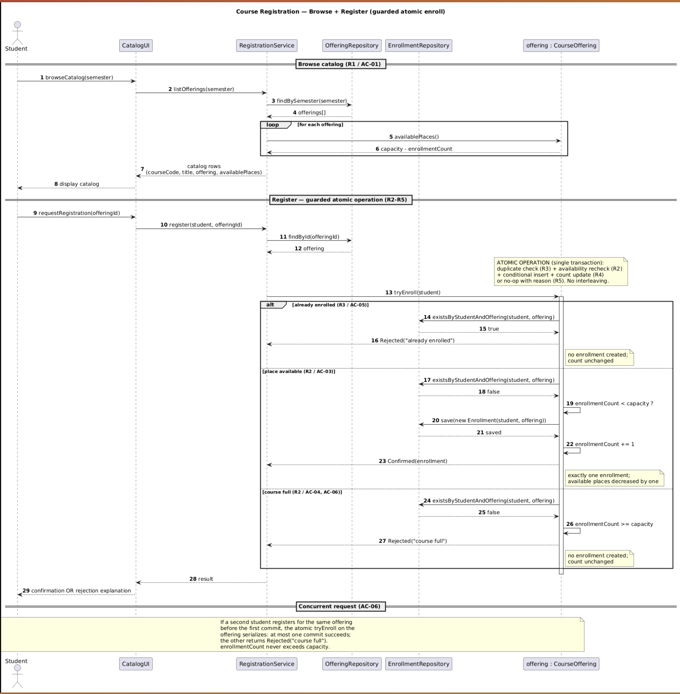
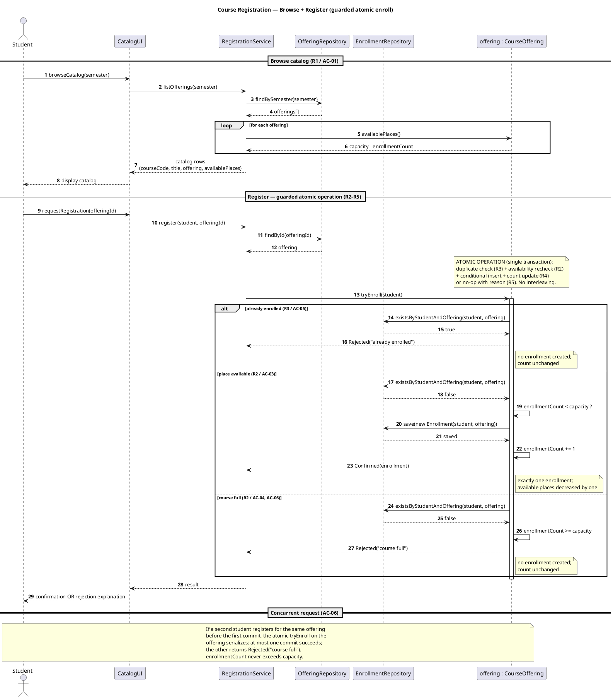
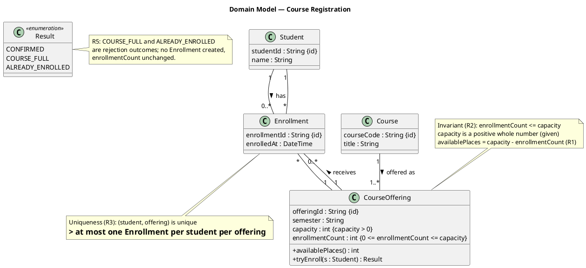

# SIS #02 — AI-Assisted UML Modeling: University Course Registration

<!--
  This is the only file you write your report in. README.md tells you what goes where.

  Rules the checker relies on:
  - Do not delete, rename or renumber the ## headings, the ### headings, or the **Label:** words.
  - Replace every "(write here)" and "(paste here)". None may be left when you submit.
  - Comments like this one are ignored by the checker and the word counter. Delete them or leave them.
-->

## 1. Scope and assumptions

<!-- Your FINAL scope statement and assumptions, after reviewing Prompt A's output. Say here
     what is out of scope (payments, prerequisites, timetable clashes, waiting lists,
     cancellation) — section 2 must not mention them. Section 10 keeps your first version. -->

**Scope:** Assumptions 1 and 2 from the prompt are already given in the scenario (single enrollment per offering is R3; positive capacity is stated). They are not treated as new requirements. No excluded features (payments, prerequisites, timetable clashes, waiting lists, cancellation) appear below

**Assumptions:**

1. One student links to one course
2. Course capacity is always positive integer

## 2. User stories and acceptance criteria

<!-- Your APPROVED requirements: Prompt A's draft after your review. Keep the IDs, the three
     story headings and the bullet shape. Every criterion names the rule(s) it maps to,
     e.g. (R2, R4). Two criteria per story. Nothing out of scope.
     Format of a criterion, on one bullet:
     - **AC-03** (R2, R4): Given ..., When ..., Then ... -->

### US-01 — Browse offerings

**US-01:** As a signed-in student, I want to browse the course catalog for one semester and see each offering's available places, so that I can choose an offering to register for.

- **AC-01** (R1): Given a signed-in student and a semester with at least one offering, When the student browses the catalog for that semester, Then each offering shows the course code, title, offering, and available places
- **AC-02** (R2): Given a signed-in student and an existing offering with capacity C and C−1 current enrollments, When the student requests registration in that offering, Then the system rechecks current availability at that moment (not the catalog's earlier value)

### US-02 — Register for an offering

**US-02:** As a signed-in student, I want to request registration in a specific offering that has places available, so that I am enrolled and receive a confirmation.

- **AC-03** (R2, R4): Given a signed-in student with no enrollment in offering X, and offering X has at least one place available, When the student requests registration in X, Then exactly one Enrollment linking that student and X is created, And X's available places decrease by one, And a confirmation is returned.
- **AC-04** (R2, R5): Given a signed-in student and offering X whose current enrollments equal its capacity, When the student requests registration in X, Then the request is rejected with the explanation "course full", And no enrollment is created, And X's enrollment count is unchanged.

### US-03 — Receive a clear rejection

**US-03:** As a signed-in student, I want to be told clearly why my registration request was rejected, so that I understand that no enrollment was created.

- **AC-05** (R3): Given a signed-in student already enrolled in offering X, When the student requests registration in X again, Then the request is rejected with the explanation "already enrolled", And no second enrollment is created, And X's enrollment count is unchanged.
- **AC-06** (R5): Given offering X with capacity C and C−1 current enrollments, When two different students each request registration in X before either completes, Then at most one enrollment is created, And the other request is rejected with "course full"

## 3. Sequence diagram

<!-- The FINAL diagram, rendered. Change .png to .svg if that is what you exported. -->



**Participants:** `Student` (the signed-in actor), `CatalogUI` (the interface the student interacts with), `RegistrationService` (orchestrates the request), `OfferingRepository` (persists and loads offerings), `EnrollmentRepository` (persists enrollments), and `offering : CourseOffering` (the domain object that owns capacity and the atomic enrollment operation).

**Atomic operation:** The final duplicate check (`existsByStudentAndOffering`), the capacity check (`enrollmentCount < capacity`), the creation (`save(new Enrollment(...))`) and the count update (`enrollmentCount += 1`) form one atomic step inside the `note over OFF` / `critical` block, so no other request can interleave. A catalog view only reads `availablePlaces()` and reserves nothing, which is why the check must be repeated after the request.

**Where the Enrollment is created:** The message `save(new Enrollment(student, offering))` sent from `offering : CourseOffering` to `EnrollmentRepository`, in the `else place available` branch. It produces one `Enrollment` in the class diagram (§4), linked to exactly one `Student` and one `CourseOffering`.

**Technical lifelines:** `CatalogUI`, `RegistrationService`, `OfferingRepository` and `EnrollmentRepository` are not classes in the domain class diagram. This is an acceptable abstraction gap: §4 shows the *domain* concepts, while the sequence shows the *runtime* collaboration that realizes the use cases; the repositories and service belong to the application layer, not the domain, and naming them here keeps the two views consistent.

## 4. Class diagram

<!-- The FINAL diagram, rendered. -->


| Association | Read left to right | Read right to left |
| --- | --- | --- |
| Student – Enrollment | One Student holds zero or more Enrollments | Each Enrollment is held by exactly one Student |
| Course – CourseOffering | One Course is offered as one or more CourseOfferings | Each CourseOffering is an offering of exactly one Course |
| CourseOffering – Enrollment | One CourseOffering receives zero or more Enrollments | Each Enrollment is received by exactly one CourseOffering |

**How an Enrollment links a student to an offering:** An Enrollment is the join entity: it carries a `studentId` reference resolved by the `Student "1" -- "0..*" Enrollment` association and an offering reference resolved by the `CourseOffering "1" -- "0..*" Enrollment` association. Every Enrollment therefore connects exactly one Student to exactly one CourseOffering, and the pair is the unit the uniqueness rule constrains.

**Capacity constraint:** `CourseOffering.enrollmentCount` must satisfy `0 <= enrollmentCount <= capacity`, with `capacity > 0`. Multiplicity alone cannot express this: the `0..*` at the Enrollment end says how many enrollments *may* exist, not that their number must stay at or below a per-offering integer `capacity`; the bound is a value-dependent invariant and must be written as a note/constraint on `CourseOffering` (R2).

**Uniqueness constraint:** For any (student, offering) pair at most one Enrollment may exist. Multiplicity cannot express this either: `Student "1" -- "0..*" Enrollment` and `CourseOffering "1" -- "0..*" Enrollment` each allow many enrollments, and nothing in the two multiplicities forbids the *same* student/offering pair appearing twice — that is a pair-level uniqueness constraint, stated separately as a note on `Enrollment` (R3).

## 5. Traceability

<!-- Every rule, including the catalog fields and availability (R1). Column 1: the rule and
     the criteria that cover it, e.g. "R2 + AC-03, AC-04". Column 2: the message, guard,
     class or constraint that shows the rule in YOUR diagrams. Column 3: the T-ID that
     exercises it, or the extra check you did instead (R1 has no T case). -->

| Rule and criterion | Model evidence | Validation case |
| --- | --- | --- |
| R1 + AC-01 | Catalog branch: `browseCatalog` → `listOfferings` → `availablePlaces()`; class note "availablePlaces = capacity − enrollmentCount" | T1 (extra check — R1 has no T case) |
| R2 + AC-02, AC-03, AC-04 | `alt` capacity guard `enrollmentCount < capacity`; `note over OFF` atomic recheck; class invariant `enrollmentCount <= capacity` | T2, T3 |
| R3 + AC-05 | `alt already enrolled` branch and `existsByStudentAndOffering`; class uniqueness note on Enrollment | T4 |
| R4 + AC-03 | `save(new Enrollment(student, offering))` and `enrollmentCount += 1`, then `Confirmed(enrollment)` | T1, T2 |
| R5 + AC-04, AC-05, AC-06 | Rejection returns `Rejected("course full")` / `Rejected("already enrolled")` with no save/update/confirm; atomic note | T3, T4 |

## 6. Walkthroughs

<!-- Walk each case through YOUR final sequence diagram, message by message. Column 2: the
     actual steps and the state change (count before → after). Column 3 starts with Pass or
     Fail, then the location: the message, guard or note where you saw it. A Fail you
     report honestly is a finding, not a penalty. -->

| Case | Observed path and state change | Judgment and evidence |
| --- | --- | --- |
| T1. Available | `requestRegistration` → `register` → `findById` → `tryEnroll` → `alt`: not already enrolled → `existsByStudentAndOffering` false → `enrollmentCount < capacity` (0 < 2) true → `save` → `enrollmentCount += 1` → `Confirmed`. Count 0 → 1. | Pass. Success branch of `tryEnroll`, guarded `else place available`; note "exactly one enrollment; available places decreased by one". |
| T2. Last place | Same path; `enrollmentCount < capacity` (1 < 2) true → `save` → count 1 → 2 → `Confirmed`. | Pass. Same success branch; after this count = capacity, no places remain. |
| T3. Full | Catalog showed a place, but on `tryEnroll` `existsByStudentAndOffering` false and `enrollmentCount >= capacity` (2 ≥ 2) true → `Rejected("course full")`, no `save`, no `+= 1`. Count stays 2. | Pass. `else course full` branch; note "no enrollment created; count unchanged". |
| T4. Duplicate | `tryEnroll` → `alt already enrolled` → `existsByStudentAndOffering` true → `Rejected("already enrolled")`, no `save`. Count stays 1. | Pass. `alt already enrolled` branch; note "no enrollment created; count unchanged". |

## 7. Review decisions

<!-- At least three substantive decisions about Prompt C's critique or your own inspection.
     Decision: accepted / rejected / modified — and what you did. Reason: why, in a full
     sentence. Rule: R1–R5. Do not invent an error to fill the table; a justified rejection
     of advice counts. -->

| AI suggestion or model element | Decision | Reason | Rule |
| --- | --- | --- | --- |
| D-2: make the three `alt` guards explicit and use a single duplicate check before the alt | Accepted (modified) | The critique is right that branch labels are not formal guards, and AC-06 depends on duplicate-before-capacity ordering being auditable, so I made the guards explicit and kept one duplicate check. | R3, R2 |
| D-3: wrap check-and-insert in a `critical`/atomic fragment rather than a note | Accepted | UML cannot prove atomicity, but the diagram should at least show the serialization mechanism; I wrapped the check and creation in a `critical` block labelled with the R5 invariant. | R5, R2 |
| D-6 / C-5: make `Result` carry the created Enrollment and the AC message strings | Rejected (kept enum) | For a domain diagram the enumeration is sufficient, and adding a result object would exceed the scope of this assignment; I instead noted that the AC message strings are returned by the sequence. | R4, R5 |

## 8. Modeling explanation

<!-- 200–300 words. Your main design choices; how the class diagram and the sequence diagram
     complement each other; why an activity diagram could also help explain the workflow. -->

The two diagrams were designed to answer different questions. The class diagram fixes the domain vocabulary — Student, Course, CourseOffering, Enrollment — and states the two rules that multiplicity alone cannot express: the capacity bound on CourseOffering and the uniqueness of the (student, offering) pair on Enrollment. The sequence diagram then shows how a registration request actually flows through those objects and where each rule is enforced at runtime: the duplicate check and the capacity recheck occur inside the atomic tryEnroll step, before any Enrollment is created, and the rejection branches return a reason without mutating state.

The two views complement each other. The class diagram tells a reader what exists and what must always hold; the sequence diagram tells a reader when those invariants are checked and how the confirmation is produced. A traceability table links each rule to both. One deliberate choice was to keep the domain classes free of application concerns and to name the service and repositories as technical lifelines, so that the domain model stays comparable across submissions.

An activity diagram could also help here, because registration is a workflow with decision points: browse, select, request, and then a fork between success, full-course and duplicate outcomes. An activity diagram would make the ordering of those decisions visually explicit and would show that the capacity check follows the duplicate check; the sequence diagram encodes the same order in its alt fragments, but less legibly for a non-technical reader.

## 9. Reflection

<!-- 150–200 words. Written by you, not by the assistant: where AI helped, one decision you
     made yourself, one remaining limitation. Specific beats flattering. -->

The assistant was fastest at converting my criteria into PlantUML syntax and at enumerating the four validation cases. I decided to keep the Result enumeration rather than the suggested EnrollmentResult object, because it suits more than the segguested one. The model still relies on a note for atomicity; a real implementation would need a database constraint or a saveIfAvailable primitive, which is outside this assignment's scope.

## 10. Appendix A — Before AI

<!-- Written BEFORE you run Prompt A, committed and pushed in your first commit, and never
     edited afterwards. This is what you paste into Prompt A as "My initial assumptions". -->

**Scope:** This model shows an already signed in student browsing a courses catalog, selecting a course and enrolling to it. The model depicts capacity, duplicate checking, and enrollment acceptance or rejection.

**Initial assumptions:**

1. One student links only to one given course.
2. Course capacity is always positive integers

## 11. Appendix B — AI exchanges

<!-- Complete prompts and complete responses, as text — never screenshots. Paste each inside
     the ~~~~ block that follows its label: AI responses contain ``` PlantUML blocks, and
     ~~~~ keeps them from breaking this file. Prompts B and C: the prompt text first, then
     the material it refers to ("below", "these two") pasted under it, in the same block.
     You may add B5, B6 … after B4 if you ran more. -->

### B1 — Requirements (Prompt A)

- **Tool:** DeepSeek
- **Model:** not displayed
- **Date:** 2026-10-18
- **Purpose:** draft 3 user stories and 6 acceptance criteria

<!-- Model: the exact model with its version, as the tool shows it (e.g. "GPT-5 Thinking",
     "Claude Sonnet 4.5"). If the tool does not show it, write: not displayed
     Date: YYYY-MM-DD -->

**Prompt:**

~~~~text
Act as a requirements analyst. Use only this course registration scenario and rules R1–R5: [
> A student browses an electronic course catalog, chooses a course offering and requests
> registration. Each offering has a limited number of places.
>
> A Course describes a subject. A CourseOffering is one scheduled section in one semester.
> Registration always targets a specific offering.
>
> Assume that the student is signed in, the selected offering exists, and its capacity is a
> positive whole number.
>
> Exclude payments, prerequisites, timetable clashes, waiting lists and cancellation. Use
> fictional students and courses.
| Rule | |
| --- | --- |
| **R1. Catalog** | Show the course code, title, offering and available places for one semester. |
| **R2. Capacity** | Recheck current availability when registering. Enrollment must never exceed the offering's capacity. |
| **R3. Duplicates** | A student may have at most one enrollment in the same offering. Reject a repeat request. |
| **R4. Success** | Create exactly one Enrollment linking the student and offering, update availability and return a confirmation. |
| **R5. Rejection** | Explain "course full" or "already enrolled". Create no enrollment and leave the enrollment count unchanged. |
]. My initial assumptions are [1. One student links only to one given course.
2. Course capacity is always positive integers].
Draft 3 user stories and 2 Given / When / Then acceptance criteria for each. Use IDs US-01 to US-03 and AC-01 to AC-06. Map each criterion to rule IDs.
Cover normal and rejection behavior. List uncertainty separately. Do not add excluded features or invent university policies.
~~~~

**Response:**

~~~~text
# Requirements Analysis: Course Registration

## Scope Note

Assumptions 1 and 2 from the prompt are already given in the scenario (single enrollment per offering is R3; positive capacity is stated). They are not treated as new requirements. No excluded features (payments, prerequisites, timetable clashes, waiting lists, cancellation) appear below.

---

## User Stories

### US-01 — Browse the catalog
**As a** signed-in student, **I want to** browse the course catalog for one semester and see each offering's available places, **so that** I can choose an offering to register for.

**Covers:** R1

### US-02 — Register successfully
**As a** signed-in student, **I want to** request registration in a specific offering that has places available, **so that** I am enrolled and receive a confirmation.

**Covers:** R2, R4

### US-03 — Be rejected on an invalid request
**As a** signed-in student, **I want to** be told clearly why my registration request was rejected, **so that** I understand that no enrollment was created.

**Covers:** R2, R3, R5

---

## Acceptance Criteria

### AC-01 — Catalog shows offering details and availability (US-01)
- **Given** a signed-in student and a semester with at least one offering
- **When** the student browses the catalog for that semester
- **Then** each offering shows the course code, title, offering, and available places
- **And** available places equal the offering's capacity minus its current enrollment count.

**Maps to:** R1 (availability check consistent with R2/R4 counting)

### AC-02 — Availability is rechecked at registration time (US-02)
- **Given** a signed-in student and an existing offering with capacity *C* and *C−1* current enrollments
- **When** the student requests registration in that offering
- **Then** the system rechecks current availability at that moment (not the catalog's earlier value)
- **And** the request proceeds because one place is available.

**Maps to:** R2

### AC-03 — Successful registration creates exactly one enrollment (US-02)
- **Given** a signed-in student with no enrollment in offering X, and offering X has at least one place available
- **When** the student requests registration in X
- **Then** exactly one Enrollment linking that student and X is created
- **And** X's available places decrease by one
- **And** a confirmation is returned.

**Maps to:** R2, R4

### AC-04 — Full offering is rejected without changing counts (US-03)
- **Given** a signed-in student and offering X whose current enrollments equal its capacity
- **When** the student requests registration in X
- **Then** the request is rejected with the explanation "course full"
- **And** no enrollment is created
- **And** X's enrollment count is unchanged.

**Maps to:** R2, R5

### AC-05 — Repeat enrollment in the same offering is rejected (US-03)
- **Given** a signed-in student already enrolled in offering X
- **When** the student requests registration in X again
- **Then** the request is rejected with the explanation "already enrolled"
- **And** no second enrollment is created
- **And** X's enrollment count is unchanged.

**Maps to:** R3, R5

### AC-06 — Enrollment never exceeds capacity under concurrent requests (US-02/US-03)
- **Given** offering X with capacity *C* and *C−1* current enrollments
- **When** two different students each request registration in X before either completes
- **Then** at most one enrollment is created
- **And** the other request is rejected with "course full"
- **And** X's enrollment count never exceeds *C*.

**Maps to:** R2, R5 (R4 for the successful one)

---

## Coverage Matrix

| Rule | Criteria |
| --- | --- |
| R1 | AC-01 |
| R2 | AC-02, AC-03, AC-04, AC-06 |
| R3 | AC-05 |
| R4 | AC-03, AC-06 |
| R5 | AC-04, AC-05, AC-06 |

Normal behavior: AC-01, AC-02, AC-03. Rejection behavior: AC-04, AC-05, AC-06 (mixed).

---

## Uncertainties (to confirm with stakeholder)

1. **Semester selection in R1** — "for one semester" implies the student picks or is shown a specific semester; the scenario doesn't say whether a default semester exists or how it is chosen. Not specified, so US-01 assumes the student browses "a semester."
2. **"Available places" display vs. stored value** — R1 says show available places; it is unspecified whether this is a stored counter or computed as capacity minus enrollments. AC-01 defines it as computed, consistent with R2/R4, but this is an interpretation.
3. **Concurrency mechanism (AC-06)** — R2 says "recheck... never exceed capacity," which implies protection against simultaneous requests, but the scenario does not state the mechanism (locking, atomic check-and-insert, etc.). AC-06 asserts the observable outcome only; the implementation approach is unstated.
4. **Order of checks when both conditions hold** — if a student is already enrolled in an offering that is also full, R5 lists both messages but does not state precedence. Not addressed in any AC.
5. **"Offering" identifier in catalog** — R1 requires showing "offering," but the format (section code, semester, instructor?) is unspecified; AC-01 leaves the offering identifier abstract.
6. **Confirmation content** — R4 requires "a confirmation" but does not specify its contents. AC-03 only asserts a confirmation is returned.
7. **One enrollment per course vs. per offering** — Assumption 1 says "one given course," but R3 is per *offering*. A student may legitimately enroll in two different offerings of the same course unless a rule forbids it; no such rule exists here. Assumption 1 is treated as meaning "per offering" (R3) and flagged as ambiguous.
8. **Definition of "current availability" timing** — R2 says "when registering"; whether the recheck occurs at request receipt or at commit is unspecified. AC-02 assumes at request processing time.
~~~~

### B2 — UML drafts (Prompt B)

- **Tool:** DeepSeek
- **Model:** not displayed
- **Date:** 2026-10-18
- **Purpose:** draft the sequence and class diagrams

**Prompt:**

~~~~text
Using my approved scenario, R1–R5, stories and criteria below, return separate PlantUML code blocks for a sequence diagram and a domain class diagram.
Sequence: include catalog browsing and guarded success, full-course and duplicate outcomes. Model final checks and creation as one atomic operation.
Class: show domain concepts, useful attributes and multiplicities. State the capacity and uniqueness constraints. Explain assumptions and any technical lifelines.
### US-01 — Browse offerings

**US-01:** As a signed-in student, I want to browse the course catalog for one semester and see each offering's available places, so that I can choose an offering to register for.

- **AC-01** (R1): Given a signed-in student and a semester with at least one offering, When the student browses the catalog for that semester, Then each offering shows the course code, title, offering, and available places
- **AC-02** (R2): Given a signed-in student and an existing offering with capacity C and C−1 current enrollments, When the student requests registration in that offering, Then the system rechecks current availability at that moment (not the catalog's earlier value)

### US-02 — Register for an offering

**US-02:** As a signed-in student, I want to request registration in a specific offering that has places available, so that I am enrolled and receive a confirmation.

- **AC-03** (R2, R4): Given a signed-in student with no enrollment in offering X, and offering X has at least one place available, When the student requests registration in X, Then exactly one Enrollment linking that student and X is created, And X's available places decrease by one, And a confirmation is returned.
- **AC-04** (R2, R5): Given a signed-in student and offering X whose current enrollments equal its capacity, When the student requests registration in X, Then the request is rejected with the explanation "course full", And no enrollment is created, And X's enrollment count is unchanged.

### US-03 — Receive a clear rejection

**US-03:** As a signed-in student, I want to be told clearly why my registration request was rejected, so that I understand that no enrollment was created.

- **AC-05** (R3): Given a signed-in student already enrolled in offering X, When the student requests registration in X again, Then the request is rejected with the explanation "already enrolled", And no second enrollment is created, And X's enrollment count is unchanged.
- **AC-06** (R5): Given offering X with capacity C and C−1 current enrollments, When two different students each request registration in X before either completes, Then at most one enrollment is created, And the other request is rejected with "course full"
~~~~

**Response:**

~~~~text
# Sequence and Domain Class Diagrams

## Assumptions and notes before the diagrams

**Diagram-level assumptions (derived from your scenario, not new policy):**
- The student is already signed in and the selected offering exists with positive integer capacity (given).
- "Available places" is computed as `capacity − enrollmentCount`; both are shown in the catalog and rechecked at registration (AC-01, AC-02, AC-03, AC-04).
- The final availability recheck, duplicate check, capacity guard, and enrollment creation are modeled as **one atomic operation** on the offering (as you requested). This is what enforces AC-06 under two simultaneous requests — at most one commit succeeds.
- Rejections return either `"course full"` or `"already enrolled"` and leave the enrollment count unchanged (AC-04, AC-05). When both could apply, this diagram does not fix precedence (flagged as uncertainty earlier); the atomic guard returns whichever condition it detects first.

**Technical lifelines in the sequence diagram:**
- `CatalogUI` — the student's client/browser view (external actor boundary).
- `RegistrationService` — application service that orchestrates browse and register.
- `OfferingRepository` — persistence access to offerings.
- `EnrollmentRepository` — persistence access to enrollments (used for the duplicate lookup and insert).
- The **atomic operation** is drawn as a single self-message/activation on the domain object `offering : CourseOffering` (`tryEnroll(student)`), so the diagram does not decompose it into races.

---

## 1. Sequence Diagram (PlantUML)



---

## 2. Domain Class Diagram (PlantUML)



---

## Constraint and multiplicity summary

| Concept | Multiplicity | Constraint | Rule |
| --- | --- | --- | --- |
| Course → CourseOffering | 1 to 1..* | One course has one or more scheduled offerings | scenario |
| CourseOffering → Enrollment | 1 to 0..* | `enrollmentCount ≤ capacity`, `capacity > 0` | R2 (given) |
| Student → Enrollment | 1 to 0..* | — | scenario |
| Enrollment → (Student, CourseOffering) | * to 1 each | `(student, offering)` unique — at most one enrollment per student per offering | R3 |
| availablePlaces | derived | `capacity − enrollmentCount` | R1, R2 |

**Notes on the class diagram:**
- `Enrollment` is modeled as an association class–style entity carrying its own id and timestamp; the uniqueness constraint is stated on the `(Student, CourseOffering)` pair (R3).
- `tryEnroll` is the single domain operation implementing the atomic guarded enrollment (R2, R3, R4, R5) — its return type `Result` distinguishes confirmation from the two rejection explanations.
- Attributes are kept minimal and only those useful to R1–R5; no payment, prerequisite, timetable, waiting-list, or cancellation concepts are introduced.
~~~~

### B3 — Model critique (Prompt C)

- **Tool:** DeepSeek
- **Model:** not displayed
- **Date:** 2026-10-18
- **Purpose:** review both models against R1–R5 and T1–T4

**Prompt:**

~~~~text
Review these two UML models against R1–R5 and my acceptance criteria. Check message order, guards, state changes, multiplicities and naming.
Inspect the four validation cases: available places, exactly one place, full course after a stale catalog view, and duplicate registration.
For each issue, cite the affected rule and model element. Explain the impact and propose a focused correction. Separate genuine defects from optional design choices.

--- MY ACCEPTANCE CRITERIA ---
### US-01 — Browse offerings

**US-01:** As a signed-in student, I want to browse the course catalog for one semester and see each offering's available places, so that I can choose an offering to register for.

- **AC-01** (R1): Given a signed-in student and a semester with at least one offering, When the student browses the catalog for that semester, Then each offering shows the course code, title, offering, and available places
- **AC-02** (R2): Given a signed-in student and an existing offering with capacity C and C−1 current enrollments, When the student requests registration in that offering, Then the system rechecks current availability at that moment (not the catalog's earlier value)

### US-02 — Register for an offering

**US-02:** As a signed-in student, I want to request registration in a specific offering that has places available, so that I am enrolled and receive a confirmation.

- **AC-03** (R2, R4): Given a signed-in student with no enrollment in offering X, and offering X has at least one place available, When the student requests registration in X, Then exactly one Enrollment linking that student and X is created, And X's available places decrease by one, And a confirmation is returned.
- **AC-04** (R2, R5): Given a signed-in student and offering X whose current enrollments equal its capacity, When the student requests registration in X, Then the request is rejected with the explanation "course full", And no enrollment is created, And X's enrollment count is unchanged.

### US-03 — Receive a clear rejection

**US-03:** As a signed-in student, I want to be told clearly why my registration request was rejected, so that I understand that no enrollment was created.

- **AC-05** (R3): Given a signed-in student already enrolled in offering X, When the student requests registration in X again, Then the request is rejected with the explanation "already enrolled", And no second enrollment is created, And X's enrollment count is unchanged.
- **AC-06** (R5): Given offering X with capacity C and C−1 current enrollments, When two different students each request registration in X before either completes, Then at most one enrollment is created, And the other request is rejected with "course full"

--- ORIGINAL SEQUENCE MODEL (models/original/sequence.puml) ---
@startuml
title Course Registration — Browse + Register (guarded atomic enroll)
skinparam sequenceMessageAlign center
autonumber

actor Student
participant "CatalogUI" as UI
participant "RegistrationService" as SVC
participant "OfferingRepository" as OFFREPO
participant "EnrollmentRepository" as ENRREPO
participant "offering : CourseOffering" as OFF

== Browse catalog (R1 / AC-01) ==
Student -> UI : browseCatalog(semester)
UI -> SVC : listOfferings(semester)
SVC -> OFFREPO : findBySemester(semester)
OFFREPO --> SVC : offerings[]
loop for each offering
  SVC -> OFF : availablePlaces()
  OFF --> SVC : capacity - enrollmentCount
end
SVC --> UI : catalog rows\n(courseCode, title, offering, availablePlaces)
UI --> Student : display catalog

== Register — guarded atomic operation (R2–R5) ==
Student -> UI : requestRegistration(offeringId)
UI -> SVC : register(student, offeringId)
SVC -> OFFREPO : findById(offeringId)
OFFREPO --> SVC : offering

note over OFF
  ATOMIC OPERATION (single transaction):
  duplicate check (R3) + availability recheck (R2)
  + conditional insert + count update (R4)
  or no-op with reason (R5). No interleaving.
end note

SVC -> OFF : tryEnroll(student)
activate OFF

alt already enrolled (R3 / AC-05)
  OFF -> ENRREPO : existsByStudentAndOffering(student, offering)
  ENRREPO --> OFF : true
  OFF --> SVC : Rejected("already enrolled")
  note right of OFF : no enrollment created;\ncount unchanged
else place available (R2 / AC-03)
  OFF -> ENRREPO : existsByStudentAndOffering(student, offering)
  ENRREPO --> OFF : false
  OFF -> OFF : enrollmentCount < capacity ?
  OFF -> ENRREPO : save(new Enrollment(student, offering))
  ENRREPO --> OFF : saved
  OFF -> OFF : enrollmentCount += 1
  OFF --> SVC : Confirmed(enrollment)
  note right of OFF : exactly one enrollment;\navailable places decreased by one
else course full (R2 / AC-04, AC-06)
  OFF -> ENRREPO : existsByStudentAndOffering(student, offering)
  ENRREPO --> OFF : false
  OFF -> OFF : enrollmentCount >= capacity
  OFF --> SVC : Rejected("course full")
  note right of OFF : no enrollment created;\ncount unchanged
end
deactivate OFF

SVC --> UI : result
UI --> Student : confirmation OR rejection explanation

== Concurrent request (AC-06) ==
note over Student, OFF
  If a second student registers for the same offering
  before the first commit, the atomic tryEnroll on the
  offering serializes: at most one commit succeeds;
  the other returns Rejected("course full").
  enrollmentCount never exceeds capacity.
end note
@enduml

--- ORIGINAL CLASS MODEL (models/original/classes.puml) ---
@startuml
title Domain Model — Course Registration
skinparam classAttributeIconSize 0

class Student {
  studentId : String {id}
  name : String
}

class Course {
  courseCode : String {id}
  title : String
}

class CourseOffering {
  offeringId : String {id}
  semester : String
  capacity : int {capacity > 0}
  enrollmentCount : int {0 <= enrollmentCount <= capacity}
  + availablePlaces() : int
  + tryEnroll(s : Student) : Result
}

class Enrollment {
  enrollmentId : String {id}
  enrolledAt : DateTime
}

class Result <<enumeration>> {
  CONFIRMED
  COURSE_FULL
  ALREADY_ENROLLED
}

Student "1" -- "0..*" Enrollment : has >
Course "1" -- "1..*" CourseOffering : offered as >
CourseOffering "1" -- "0..*" Enrollment : receives >
Enrollment "*" -- "1" Student
Enrollment "*" -- "1" CourseOffering

note top of CourseOffering
  Invariant (R2): enrollmentCount <= capacity
  capacity is a positive whole number (given)
  availablePlaces = capacity - enrollmentCount (R1)
end note

note bottom of Enrollment
  Uniqueness (R3): (student, offering) is unique
  => at most one Enrollment per student per offering
end note

note right of Result
  R5: COURSE_FULL and ALREADY_ENROLLED
  are rejection outcomes; no Enrollment created,
  enrollmentCount unchanged.
end note
@enduml
~~~~

**Response:**

~~~~text
# Review of the Course Registration Models Against R1–R5 and AC-01…AC-06

Below I separate **genuine defects** (model contradicts a rule or acceptance criterion) from **optional design choices** (defensible but worth flagging). For each defect I cite the rule, the model element, the impact, and a focused correction.

---

## 1. Sequence model

### 1.1 Genuine defects

**D-1 — Browse step reads `availablePlaces()` directly on the in-memory `offering` object, bypassing a consistent source (R1 / AC-01).**
- *Element:* `SVC -> OFF : availablePlaces()` inside `loop for each offering`.
- *Impact:* AC-01 only requires displaying available places, so this is not a hard violation of R1, but the aggregation `capacity − enrollmentCount` is computed per offering while `findBySemester` has already returned a snapshot. If offerings are re-read individually, the catalog can show inconsistent values across rows (some from the snapshot, some fresh). Minor, but it undermines "each offering shows … available places" as a coherent view.
- *Correction:* Either (a) have `findBySemester` return projections that already include `availablePlaces`, or (b) keep the per-offering call but make it explicit that all rows are read within one read-consistent unit (e.g., one transaction / one query). Naming note: the returned value `capacity - enrollmentCount` is a *computed* value; consider renaming the message to `availablePlaces()` only on `CourseOffering` (it is already a method there — good), rather than restating the formula in the reply label.

**D-2 — The `alt` branches all begin by calling `existsByStudentAndOffering`, producing three separate duplicate-check calls (R3 / AC-05).**
- *Element:* The three `OFF -> ENRREPO : existsByStudentAndOffering(...)` calls, one per `alt` branch.
- *Impact:* Logically the duplicate check is performed once per request in exactly one branch (the branches are mutually exclusive), so it is not a correctness defect. However, the diagram reads as if the check is triplicated, and a reader cannot tell from the sequence whether the *first* branch's check is what routes control to the third branch. The routing condition for branch 3 ("course full") is only established by `OFF -> OFF : enrollmentCount >= capacity` *after* the duplicate check — fine — but the `alt` guards are implicit (branch labels), not explicit `[guard]` conditions.
- *Impact (guards):* UML `alt` operands should carry explicit guards. Here the guards are prose labels (`already enrolled (R3 / AC-05)`, etc.) rather than `[condition]` guards. This is a **modeling-style defect** that matters because AC-06 depends on the *ordering* of checks: duplicate check must precede availability check (a student already enrolled must get "already enrolled", not "course full"). The current labels do encode that order, but not as formal guards.
- *Correction:* Add explicit guards, e.g. `[existsByStudentAndOffering = true]`, `[existsByStudentAndOffering = false and enrollmentCount < capacity]`, `[existsByStudentAndOffering = false and enrollmentCount >= capacity]`, and keep a single duplicate-check call before the `alt` (or inside a preceding `opt`). This makes the R3-before-R2 ordering auditable.

**D-3 — `enrollmentCount += 1` is modeled as a self-message on `OFF`, i.e., the count is mutated on the domain object, but the class model declares `enrollmentCount` with an invariant `0 <= enrollmentCount <= capacity` and does not show the increment as an operation (R2, R4 / AC-03, AC-04).**
- *Element:* `OFF -> OFF : enrollmentCount += 1`; class `CourseOffering.enrollmentCount : int {0 <= enrollmentCount <= capacity}`.
- *Impact:* Not strictly wrong (a self-message on the object that owns the attribute is legitimate), but the class model exposes `tryEnroll(s : Student) : Result` while the sequence shows the *caller* (`SVC`) orchestrating `existsByStudentAndOffering`, `save`, and `enrollmentCount += 1` on `OFF`. The responsibility boundary is inconsistent: in the class model `tryEnroll` is the atomic operation on `CourseOffering`; in the sequence the atomicity note sits over `OFF` but the individual steps are drawn as separate messages, and the "single transaction / no interleaving" claim is a **note**, not modeled. That is the crux of R5/AC-06.
- *Impact (R5/AC-06):* The concurrency guarantee ("at most one commit succeeds") is asserted only in a free-text note and in the "Concurrent request" trailing note. UML cannot *prove* atomicity from a sequence diagram, but the model should at least show the serialization mechanism (e.g., a critical region / `par`/`critical` fragment, or a database-level `saveIfAvailable` returning affected-rows). As drawn, `existsByStudentAndOffering` → `enrollmentCount < capacity` → `save` → `+= 1` is a classic check-then-act race; the note claims it is atomic, but nothing in the diagram enforces it.
- *Correction:* Wrap the check-and-insert in an explicit `critical` (or `par` with a single winning `alt`) fragment labeled with the R5 invariant, *or* replace the four messages with one `OFF -> ENRREPO : saveIfAvailable(student, offering)` returning `saved | duplicate | full`, which is the actual atomic primitive. Add a formal guard note that `enrollmentCount` is never read-then-written outside this critical region.

**D-4 — "Browse" does not verify the student is signed in (R1 context / AC-01 "Given a signed-in student").**
- *Element:* `Student -> UI : browseCatalog(semester)` with no authentication/authorization step.
- *Impact:* AC-01's precondition ("signed-in student") is not represented. This is a **precondition-modeling gap**, not a behavioral contradiction. For a domain sequence focused on registration rules this is arguably out of scope, but since the ACs are stated "given a signed-in student", the model should at least show the session/actor as authenticated (e.g., `Student [authenticated]` or a guard `[session.valid]`).
- *Correction:* Add a lifeline note or guard `[student.isSignedIn]` on `browseCatalog` and `requestRegistration`.

**D-5 — Naming inconsistency: `Result` enumeration vs. sequence return values (R5 / AC-04, AC-05).**
- *Element:* Class model `Result { CONFIRMED, COURSE_FULL, ALREADY_ENROLLED }`; sequence returns `Confirmed(enrollment)`, `Rejected("already enrolled")`, `Rejected("course full")`.
- *Impact:* Three different vocabularies for the same outcome. AC-04/AC-05 require the *explanations* "course full" and "already enrolled" to be returned. The sequence's string literals match the ACs; the class enumeration uses SCREAMING_CASE constants and `CONFIRMED` rather than a confirmation payload. This is a **traceability/naming defect**: a reader cannot map `Result.COURSE_FULL` to the AC string without inference.
- *Correction:* Make the class model carry the user-facing message, e.g. `Result { CONFIRMED, COURSE_FULL("course full"), ALREADY_ENROLLED("already enrolled") }`, or add a `message : String` attribute derived from the constant. Keep the sequence literals as the canonical AC text.

**D-6 — `tryEnroll` return type `Result` cannot carry the created `Enrollment`, yet the sequence returns `Confirmed(enrollment)` (AC-03 "exactly one Enrollment … confirmation").**
- *Element:* `CourseOffering.tryEnroll(s : Student) : Result` vs. `OFF --> SVC : Confirmed(enrollment)`.
- *Impact:* AC-03 requires a confirmation that evidences the single enrollment. A bare enum `CONFIRMED` loses the enrollment identity. This is a **type/model mismatch** that weakens AC-03 traceability.
- *Correction:* Change to `tryEnroll(s : Student) : EnrollmentResult` where `EnrollmentResult` is a small result object `{ outcome : Result, enrollment : Enrollment [0..1] }`, with the invariant `outcome = CONFIRMED ⇔ enrollment ≠ null`.

**D-7 — Duplicate-registration check uses the `offering` object as the second argument, but the repository query is keyed by `(student, offering)`; the class model's uniqueness note is on `Enrollment`, not enforced anywhere in the sequence (R3 / AC-05).**
- *Element:* `existsByStudentAndOffering(student, offering)`; class note "Uniqueness (R3): (student, offering) is unique".
- *Impact:* The check-then-act pattern means two concurrent duplicate requests from the *same* student could both pass `existsByStudentAndOffering = false` and both insert, violating R3. AC-05 is stated sequentially ("Given … already enrolled … When … again"), so it is satisfied for the sequential case; but the R3 uniqueness note in the class model claims a stronger invariant than the sequence enforces. This is a **genuine concurrency gap for R3**, parallel to D-3 for R5.
- *Correction:* Enforce uniqueness with a database unique constraint on `(studentId, offeringId)` (model it as `{unique}` on the association or as a constraint note), and treat a constraint violation as `ALREADY_ENROLLED`. The sequence should show `save` returning either `saved` or `duplicate` rather than relying on a pre-check alone.

### 1.2 Optional design choices (flag, don't fail)

- **O-1 — `SVC` orchestrates repository calls while `OFF` also calls `ENRREPO`.** Layering is mixed (service *and* entity both talk to repositories). Defensible for a domain-rich `CourseOffering`, but if you keep `tryEnroll` on the entity, the service should not also call `existsByStudentAndOffering`/`save`. Pick one owner.
- **O-2 — Browse loop calls `availablePlaces()` per offering.** N+1-ish, but acceptable for a catalog view; a projection query is an optimization, not a rule.
- **O-3 — `Rejected("...")` as a return message.** Fine; could be modeled as a `Result` object return for symmetry with the class model (see D-5/D-6).
- **O-4 — `autonumber` without fragment labels.** Cosmetic; helps traceability if fragments are labeled `ref AC-03` etc.

---

## 2. Class model

### 2.1 Genuine defects

**C-1 — `CourseOffering.enrollmentCount` is a derived/denormalized attribute with an invariant, but the model does not mark it `{derived}` nor tie it to `Enrollment` multiplicity (R2, R4).**
- *Element:* `enrollmentCount : int {0 <= enrollmentCount <= capacity}`; associations `CourseOffering "1" -- "0..*" Enrollment`.
- *Impact:* The multiplicity `0..*` on `CourseOffering – Enrollment` means the number of linked `Enrollment`s is the ground truth, while `enrollmentCount` is a cached copy. The invariant `enrollmentCount <= capacity` and the AC-03/AC-04 behavior depend on these two staying in sync. The model does not state `enrollmentCount = Enrollment->select(offering = self)->size()`, so a reader cannot tell whether the count is authoritative or derived. This is the class-side counterpart of D-3.
- *Correction:* Mark it `enrollmentCount : int {derived, 0 <= enrollmentCount <= capacity}` and add a constraint `enrollmentCount = self.enrollments->size()`; or, if it is a stored counter for performance, add an explicit `{redefines}`/maintenance note and require the atomic update from D-3.

**C-2 — Capacity constraint `{capacity > 0}` is stated, but AC-04/AC-06 require the *full* boundary `enrollmentCount = capacity` to be reachable; the invariant allows it, yet there is no guard that `tryEnroll` rejects at equality (R5 / AC-04, AC-06).**
- *Element:* `capacity : int {capacity > 0}`, `enrollmentCount : int {0 <= enrollmentCount <= capacity}`, `tryEnroll(...) : Result`.
- *Impact:* The invariant permits `enrollmentCount = capacity` but does not by itself state that `tryEnroll` must return `COURSE_FULL` at that point. The sequence shows it, the class model does not. For AC-04 ("current enrollments equal capacity → rejected 'course full'") the class model should carry a precondition/postcondition on `tryEnroll`.
- *Correction:* Add operation contract: `tryEnroll(s) : EnrollmentResult` with
  - pre: `s ∉ self.enrollments` (else `ALREADY_ENROLLED`),
  - pre: `enrollmentCount < capacity` (else `COURSE_FULL`),
  - post (success): `enrollmentCount' = enrollmentCount + 1 ∧ self.enrollments' = self.enrollments ∪ {new Enrollment(s, self)}`,
  - post (reject): `enrollmentCount' = enrollmentCount ∧ self.enrollments' = self.enrollments`.

**C-3 — Uniqueness of `(student, offering)` is a note, not a constraint on the association/class (R3 / AC-05).**
- *Element:* `note bottom of Enrollment` "Uniqueness (R3): (student, offering) is unique".
- *Impact:* Notes are not constraints; the multiplicities `Enrollment "*" -- "1" Student` and `Enrollment "*" -- "1" CourseOffering` allow many enrollments per pair. The R3 invariant is therefore **not expressed in the model's multiplicities or constraints**, only in prose. This is a genuine modeling defect for traceability of AC-05/AC-06.
- *Correction:* Add `{unique}` on the `(Student, CourseOffering)` pair — e.g., a constraint `{unique (student, offering)}` on `Enrollment`, or replace the two binary associations with an association class `Enrollment` on `Student — CourseOffering` with multiplicity `0..1` at the `Enrollment` end per pair. Also state the concurrency enforcement (D-7).

**C-4 — `Course "1" -- "1..*" CourseOffering` vs. US-01 "a semester with at least one offering" — the catalog is per *semester*, but `semester` is an attribute of `CourseOffering`, not a first-class entity (R1 / AC-01).**
- *Element:* `CourseOffering.semester : String`; `findBySemester(semester)` in the sequence.
- *Impact:* Not a contradiction, but AC-01 scopes browsing to "one semester". With `semester` as a free-text string on each offering, there is no guarantee that `findBySemester` returns a well-defined set, nor that `semester` is normalized. For a domain model this is acceptable; for AC-01 traceability it is weak. **Optional-to-borderline.**
- *Correction:* If you want AC-01 fully modeled, introduce `Semester` as an entity (`code`, `year`, `term`) and make `CourseOffering "0..*" -- "1" Semester`. Otherwise at least type it `semester : SemesterCode` (value object).

**C-5 — `Result` enumeration lacks the user-facing messages required by AC-04/AC-05 (R5).**
- *Element:* `Result { CONFIRMED, COURSE_FULL, ALREADY_ENROLLED }`.
- *Impact:* Same as D-5: the ACs mandate the exact explanations "course full" and "already enrolled". The enumeration constants do not carry them.
- *Correction:* As in D-5 — attach `message` to each constant, or define `Result` as a class with `code` and `message`.

**C-6 — `Student "1" -- "0..*" Enrollment : has >` and `Enrollment "*" -- "1" Student` are redundant/contradictory in multiplicity notation (naming/multiplicity defect).**
- *Element:* Two associations between `Student` and `Enrollment`, and two between `CourseOffering` and `Enrollment`.
- *Impact:* The pair `Student "1" -- "0..*" Enrollment` and `Enrollment "*" -- "1" Student` describe the *same* association twice with different navigability/roles. This is a **modeling error** (duplicate association) that makes multiplicities ambiguous to tooling and readers. Same for `CourseOffering "1" -- "0..*" Enrollment` + `Enrollment "*" -- "1" CourseOffering`.
- *Correction:* Keep one association per pair with explicit role names, e.g. `Student "1" -- "0..*" Enrollment : enrollments >` and `CourseOffering "1" -- "0..*" Enrollment : enrollments >`, and delete the reverse duplicates. If you want the association class pattern, use `(Student, CourseOffering) association class Enrollment` with `0..1` per pair (see C-3).

### 2.2 Optional design choices

- **O-5 — `availablePlaces()` and `tryEnroll()` on the entity.** Good domain-driven choice; just make the contracts explicit (C-2).
- **O-6 — `enrolledAt : DateTime`.** Reasonable; could be `{readOnly}` after creation.
- **O-7 — No `Semester` entity (C-4).** Acceptable for a small model; only matters if AC-01 traceability to a semester aggregate is required.

---

## 3. The four validation cases

| Case | Rule / AC | Sequence model | Class model | Verdict |
|---|---|---|---|---|
| **Available places shown in catalog** | R1 / AC-01 | `loop … availablePlaces()` returns `capacity − enrollmentCount`; shows courseCode, title, offering, availablePlaces. | `availablePlaces() : int`, invariant note. | **Passes** AC-01 content-wise. Minor: D-1 (snapshot consistency), D-4 (signed-in precondition not shown). |
| **Exactly one place left (C−1 enrollments), one student registers** | R2 / AC-03 (and AC-02) | Branch "place available": duplicate check false, `enrollmentCount < capacity` true, save, `+= 1`, `Confirmed(enrollment)`. | `tryEnroll` contract not explicit; `enrollmentCount` derived-ness unclear (C-1). | **Passes sequentially** (one enrollment, count +1, confirmation). Fails traceability: `Confirmed(enrollment)` not carried by `Result` (D-6); atomicity only in note (D-3). AC-02 ("recheck at that moment") is satisfied because the sequence rechecks in `tryEnroll` rather than using the browse value — **good**. |
| **Full course after a stale catalog view** | R2, R5 / AC-04 (and AC-02) | Catalog earlier showed a place; on register, `tryEnroll` rechecks `enrollmentCount >= capacity` → `Rejected("course full")`, no save, count unchanged. | Invariant allows `enrollmentCount = capacity`; no operation contract forcing `COURSE_FULL` at equality (C-2). | **Passes** in the sequence (R2 recheck + R5 rejection + no mutation). Class model should add the `tryEnroll` precondition/postcondition to make AC-04 auditable. This case is exactly what the "recheck at that moment" note in AC-02 demands — the sequence does recheck, so **no defect on R2**; only C-2 is a traceability gap. |
| **Duplicate registration** | R3 / AC-05 | Branch "already enrolled": `existsByStudentAndOffering` true → `Rejected("already enrolled")`, no save, count unchanged. | Uniqueness only in a note, multiplicities allow `*` per pair (C-3); no DB unique constraint shown (D-7). | **Passes sequentially**, fails model-level enforcement: R3 is not expressed as a constraint, and the check-then-act pattern is racy for concurrent duplicates (D-7). AC-05's message string is correct in the sequence but absent from `Result` (C-5). |

**AC-06 (concurrent, one place left, two students)** is not one of the four cases you listed, but it is the one where the models are weakest: the guarantee rests entirely on free-text notes (`note over OFF`, trailing "Concurrent request" note) and on an unmodeled atomic `tryEnroll`. D-3 and D-7 are the fixes that make AC-06 credible.

---

## 4. Summary of required corrections (ranked)

1. **Model the atomicity explicitly** (D-3, D-7): replace check-then-act with a single atomic `saveIfAvailable` / `critical` fragment; enforce `(student, offering)` uniqueness at the persistence level. *Affects R3, R5, AC-05, AC-06.*
2. **Add explicit `alt` guards and a single duplicate check** (D-2), preserving the R3-before-R2 order. *Affects AC-04, AC-05, AC-06.*
3. **Make `Result` carry the AC messages and the enrollment** (D-5, D-6, C-5): `EnrollmentResult { outcome, enrollment?, message }` with `CONFIRMED ⇔ enrollment ≠ null`. *Affects AC-03, AC-04, AC-05.*
4. **Express R3 as a constraint, not a note, and remove duplicate associations** (C-3, C-6). *Affects AC-05.*
5. **Add `tryEnroll` operation contract and mark `enrollmentCount` derived or maintenance-required** (C-1, C-2). *Affects AC-03, AC-04.*
6. **Add signed-in precondition and (optionally) a `Semester` value object** (D-4, C-4). *Affects AC-01 context.*

Items O-1…O-7 are design choices, not defects. The most consequential *optional* one is O-1 (mixed layering: `SVC` and `OFF` both call repositories) — it is defensible, but it is the root cause that makes D-3 harder to see, so if you fix D-3 you will likely also want to resolve O-1 by giving `tryEnroll` sole ownership of the atomic operation and stripping the repository calls out of `SVC`.
~~~~

### B4 — Focused revision (Prompt D)

- **Tool:** DeepSeek
- **Model:** not displayed
- **Date:** 2026-10-18
- **Purpose:** apply my accepted review decisions

**Prompt:**

~~~~text
(paste here)
~~~~

**Response:**

~~~~text
(paste here)
~~~~

## 12. Appendix C — Original diagrams

<!-- The AI's first output from Prompt B, rendered unedited from models/original/. -->


## 13. Appendix D — References and source checks

### References

<!-- Full references, one per line, each starting with "- ". Only sources you actually opened.
     Every URL used in the source checks must also appear here. Example:
     - Sommerville, I. (2016). Software Engineering, 10th ed., Global Edition. Pearson. Ch. 5. -->

- (write here)

### Source checks

<!-- At least two modeling decisions you verified. Source and locator: title + slide, page,
     section, chapter or figure — or title + URL + access date (YYYY-MM-DD). Slide numbers
     refer to the decks posted in our Teams. -->

| Modeling decision | Source and locator | What the source says | How it supports or changed your model |
| --- | --- | --- | --- |
| (write here) | (write here) | (write here) | (write here) |
| (write here) | (write here) | (write here) | (write here) |
